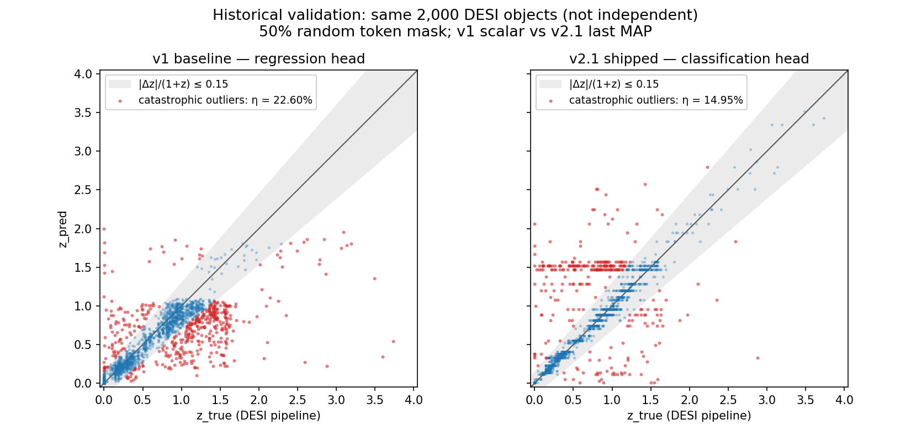

# DESI Spectra Foundation Model

> Versión en español del [README.md](README.md). El README en inglés es la referencia; ante cualquier diferencia, prevalece el inglés.

[](https://github.com/Julian0444/desi-spectra-fm/actions/workflows/ci.yml)
[](https://huggingface.co/jirustaroure/desi-spectra-fm)
[](https://huggingface.co/spaces/jirustaroure/desi-spectra-fm-demo)
[](https://jirustaroure-desi-fm-api.hf.space/api/docs)

Transformer multitarea de 26M de parámetros para espectros DESI de galaxias,
cuásares y estrellas: estima redshift y reconstruye regiones enmascaradas.
No usa pesos preentrenados externos: v1 partió de inicialización aleatoria y
v2.1 es un fine-tune de v1. Incluye Python, demo Gradio, API FastAPI servida en
un Space Gradio y herramientas para un agente experimental.

Corrección local de octubre de 2026, pendiente de publicación. El nombre
histórico del repositorio no demuestra transferencia a otros instrumentos o
tareas. [Evidencia y límites](docs/HISTORICAL_EVIDENCE.md).

**[▶ Demo en vivo](https://huggingface.co/spaces/jirustaroure/desi-spectra-fm-demo)** ·
**[🤗 Pesos del modelo](https://huggingface.co/jirustaroure/desi-spectra-fm)** ·
**[📡 API REST](https://jirustaroure-desi-fm-api.hf.space/api/docs)** ·
**[🤖 Agente LLM: spectra-copilot](https://github.com/Julian0444/spectra-copilot)** ·
**[📓 Notebook de evaluación](notebooks/evaluation.ipynb)**


---

## Resultados: diagnóstico y corrección de un modo de falla real

La baseline v1 predecía el redshift con una cabeza de regresión escalar, y regresaba a la media:
**22.6 % de outliers catastróficos** en datos held-out, un máximo observado de predicción cercano a z = 2 y
una tasa de falla de 82.7 % exactamente donde viven los cuásares (z ∈ [1.5, 2.5)). Tras
diagnosticarlo con las métricas estándar de los relevamientos (η, σ_NMAD, sesgo por bin), la
cabeza se rediseñó como una **clasificación de 100 bins sobre log(1+z)** (con pesos de clase
sqrt-inverse del histograma real de etiquetas) y v1 se ajustó por fine-tuning hasta la
**v2.1** publicada:



| métrica (2.000 espectros históricos de validación; máscara aleatoria del 50%) | v1 baseline | **v2.1 (publicada)** |
|---|---|---|
| fracción de outliers catastróficos η₀.₁₅ | 22.6 % | **14.95 %** |
| σ_NMAD (dispersión robusta) | 0.083 | **0.030** |
| media de \|Δz\| / (1+z) | 0.107 | **0.096** |
| η₀.₁₅ en z ∈ [1.5, 2.5) — la banda de los cuásares | 82.7 % | **23.5 %** |
| máximo observado (no el rango configurado) | 2.00 | **3.52** |
| RMSE de reconstrucción enmascarada (espacio arcsinh) | 0.819 | 0.817 |

Los 2.000 objetos se excluyeron del fine-tuning v2.1, pero la reconstrucción del
cargador histórico sostiene fuertemente su exposición durante v1. También se
usaron para seleccionar checkpoints: **no son un test independiente**.
Best y last contienen los mismos 117 tensores en el paso 30.000. Las tasas
15.15% y 14.95% proceden de máscaras aleatorias distintas, sin semilla fijada;
no definen un intervalo de confianza ni hacen de last un modelo mejor.

`z_confidence = 1 − H(p)/log(100)` ordena el riesgo retrospectivamente: con
umbral 0.5 quedan 1.175/2.000 objetos (58.75%) y 9 errores (0.77%); AUROC 0.9038.
No es una probabilidad calibrada ni una política validada para el servicio.
La reconstrucción da RMSE cercano a 0.82. La comparación exploratoria con media
móvil sobre 50 ejemplos no demuestra superioridad ni equivalencia; sus anchos
se exploraron en esos mismos datos. Entre v1 y v2.1 cambiaron varias decisiones,
por lo que la mejora no puede atribuirse a una sola. [Fuentes](docs/HISTORICAL_EVIDENCE.md).

## Embeddings del encoder

`embed_spectrum()` promedia (mean-pooling) los tokens espectrales válidos del encoder en un
vector de 512 dimensiones. 15k espectros de entrenamiento, embebidos y proyectados con UMAP,
coloreados por su redshift de catálogo:


El encoder se entrenó conjuntamente con una pérdida supervisada de redshift.
La UMAP describe 15.000 objetos de entrenamiento; no prueba transferencia ni
aprendizaje solo por reconstrucción. Estos embeddings alimentan el índice FAISS
usado por el copiloto.

## Del modelo al producto

CI ejecuta pruebas unitarias; no cubre los wrappers de Spaces, Docker ni el checkpoint real:

- **[Demo en vivo](https://huggingface.co/spaces/jirustaroure/desi-spectra-fm-demo)** (Gradio en
  HF Spaces): espectros held-out reales, enmascarado interactivo, subí tu propio `.npz`. (Los
  cuatro espectros de ejemplo viven en `examples/`, que acá está gitignored; ver
  [Estructura del repositorio](#estructura-del-repositorio).)
- **[API REST](https://jirustaroure-desi-fm-api.hf.space/api/docs)** (FastAPI servida en Space Gradio; Dockerfile para uso local):
  mandá un espectro con `curl` y recibí redshift + confianza en ~1–3 s. [Detalles más abajo](#api-rest-fastapi).
- **[spectra-copilot](https://github.com/Julian0444/spectra-copilot)**: un agente LLM (tool use
  de la API de Claude) que trata a este modelo como un instrumento más entre varios: contrasta las predicciones con líneas mediante una heurística de picos de emisión, las contrasta con los
  vecinos más cercanos de FAISS, fundamenta su razonamiento en un mini-corpus RAG con citas
  (BM25; 6/6 IDs de citas encontrados en los documentos recuperados de tres corridas históricas; esto no mide respaldo científico) y expone todo el conjunto de herramientas como un **servidor MCP**.
- **[Evals end-to-end](https://github.com/Julian0444/spectra-copilot#end-to-end-evals-does-verification-actually-help-n--150)**
  (n = 150 espectros held-out) con el titular honesto: el modelo solo le gana a su propio
  agente con un LLM barato (92.7 % vs 79.3 % dentro de su protocolo), pero la confianza
  autorreportada del agente sigue a la exactitud de forma monótona, así que una política
  híbrida "agente solo cuando está confiado" alcanza 90.0 %, inferior al 92.7% del modelo solo y calculado retrospectivamente. La eval cazó una falla relevante
  para el despliegue que las demos habían escondido.

## Arquitectura

```
espectro (flux + wavelength en Å; evidencia limitada a DESI)
  → interpolación a una grilla log-λ (3600–9800 Å, 7081 px; los px fuera de cobertura se marcan inválidos)
  → 273 parches × 26 px → proyección lineal → tokens (+ posiciones sinusoidales de log-λ)
  → encoder transformer de 8 capas (d_model = 512, 8 heads, 26 M parámetros)
  → cabeza de reconstrucción (por token)           → reconstrucción de regiones enmascaradas, devuelta a tu grilla
  → cabeza de redshift (token siempre enmascarado) → posterior de 100 bins sobre log(1+z) → z + confianza
```

La interpolación admite otras grillas. La codificación de longitud de onda
no demuestra precisión con otros instrumentos ni cobertura parcial.

**Stack:** PyTorch · Hugging Face Hub + Spaces · Gradio · FastAPI · Docker · GitHub Actions ·
FAISS · API de Claude + MCP (repo del agente).

## Inicio rápido (3 comandos)

```bash
python3 -m pip install -r requirements.txt && python3 -m pip install -e .
python3 -m pytest tests/ -q        # historical counts: see docs/BATCH_5.md
CKPT=$(python3 -c "from huggingface_hub import hf_hub_download; print(hf_hub_download('jirustaroure/desi-spectra-fm', 'checkpoint_last.pt'))") \
  && python3 -m desi_fm.predict --checkpoint "$CKPT" --input YOUR_SPECTRA.npz --output predictions.npz
```

Evidencia vigente y alcance de las pruebas: [lote 5](docs/BATCH_5.md).

Python 3.9+, PyTorch 2.x (MPS / CUDA / CPU). La inferencia solo necesita NumPy + PyTorch;
`huggingface_hub` descarga una vez el checkpoint v2.1 publicado (~104 MB, queda en caché). Los
tests ejercitan shapes, forwards sintéticos y el split del cargador actual;
no prueban la independencia del linaje v1 ni la calidad del checkpoint real.

Para la evaluación completa con gráficos —métricas, análisis de sesgo/outliers, galería de
reconstrucciones, curvas de entrenamiento, inferencia en vivo— abrí
[`notebooks/evaluation.ipynb`](notebooks/evaluation.ipynb) (viene preejecutado; las secciones
1–3 corren offline a partir de artefactos commiteados).

## Cómo se entrenó

Íntegramente en una MacBook (Apple MPS), con streaming de espectros DESI EDR/SV3 del dataset
[Multimodal Universe](https://github.com/MultimodalUniverse/MultimodalUniverse):

1. **v1**: preentrenamiento masked-token + regresión escalar conjunta de z sobre 50k espectros válidos de un stream barajado.
2. **v2.1**: v1 ajustada por fine-tuning sobre los primeros 80k espectros × 3 épocas con la
   cabeza de clasificación (cross-entropy normalizada por log(n_bins), pesos de pérdida 1:1 con
   la reconstrucción).
3. **Validación histórica**: los 2.000 objetos válidos siguientes a los primeros
   80k. Excluidos de v2.1, con exposición v1 fuertemente respaldada y selección
   de checkpoints. No constituyen un test independiente.

Los flags históricos están en
[`training_args.json`](runs/desi_80k_classhead_v21/training_args.json).
El fine-tuning requiere el checkpoint v1 y el histograma local, ausentes de un
clon limpio. Documentar la receta no garantiza una repetición exacta.

---

## Referencia

Todo lo que sigue documenta las interfaces en detalle (formatos, APIs, estructura, fundamentos
de diseño).

### Mapa de la documentación

| archivo | para quién | qué contiene |
|---|---|---|
| [README.md](README.md) | todos (empezá acá) | resultados, links al producto, inicio rápido, interfaces |
| [README.es.md](README.es.md) | lectores hispanohablantes | traducción completa al español de este README (el inglés es la referencia) |
| [DELIVERABLE.md](DELIVERABLE.md) | docente / TA, lectores técnicos | informe técnico: arquitectura, decisiones de diseño, progresión de métricas, gates de release |
| [model_card.md](model_card.md) | visitantes del Hub de Hugging Face | la model card publicada como README del Hub (métricas, uso, limitaciones, archivos) |
| [COMO_FUNCIONA.md](COMO_FUNCIONA.md) | lectores hispanohablantes nuevos en el código | recorrido archivo por archivo del código, en español |
| [api/README.md](api/README.md) | usuarios de la API / mantenedores del Space | el Space de la API REST: endpoints, ejemplos con curl, despliegue |
| [demo/README.md](demo/README.md) | usuarios de la demo / mantenedores del Space | el Space de la demo Gradio: qué muestra, cómo está desplegado |
| [notebooks/evaluation.ipynb](notebooks/evaluation.ipynb) | quienes revisan los números | evaluación preejecutada: métricas, gráficos de sesgo/outliers, comparación v1 → v2.1, galería de reconstrucciones, inferencia en vivo |
| [docs/HISTORICAL_EVIDENCE.md](docs/HISTORICAL_EVIDENCE.md) | revisión | protocolos, hashes y límites |

### Formato de entrada

`YOUR_SPECTRA.npz` es un archivo NumPy `.npz`. **Obligatorio:**

| clave | dtype | shape | significado |
|---|---|---|---|
| `flux` | float32 | `(N, P)` o `(P,)` | flujo observado, cualquier unidad |
| `wavelength` | float32 | `(N, P)` o `(P,)` | longitudes de onda en Ångströms |

**Opcional:**

| clave | dtype | shape | significado |
|---|---|---|---|
| `ivar` | float32 | `(N, P)` | varianza inversa |
| `mask` | bool | `(N, P)` | `True` = píxel malo / inutilizable |

Si `wavelength` es 1-D, la misma grilla se reutiliza para todos los espectros. Un `flux` 1-D se
trata como un único espectro.

### Formato de salida

`predictions.npz` contiene:

| clave | shape | significado |
|---|---|---|
| `z_pred_map` | `(N,)` | **redshift predicho oficial** (argmax del posterior; checkpoints de clasificación como v2.1) |
| `z_confidence` | `(N,)` | concentración del posterior en [0, 1] (checkpoints de clasificación) |
| `z_pred` | `(N,)` | `expm1(E[log(1+z)])` del mismo posterior (v1 usa regresión escalar) |
| `reconstruction_input_grid` | `(N, P)` | reconstrucción sobre tu grilla de longitudes de onda, en tus unidades de flujo |
| `reconstruction_model_grid` | `(N, 7081)` | reconstrucción sobre la grilla log-λ interna del modelo |
| `model_wavelength` | `(7081,)` | la grilla interna de longitudes de onda del modelo (3600–9800 Å, espaciado logarítmico) |
| `spectrum_mask` | `(N, 273)` bool | cuáles de las 273 posiciones de token se enmascararon |
| `center`, `scale` | `(N,)` | estadísticos de normalización por espectro aplicados internamente |

### Modo benchmark de reconstrucción

Por defecto el modelo recibe el espectro de entrada completo y se le pide que prediga `z`. Para
hacer benchmark de la **reconstrucción de regiones enmascaradas**, pasá `--mask-ratio` para
enmascarar al azar esa fracción de las 273 posiciones de token antes del forward pass:

```bash
python3 -m desi_fm.predict \
    --checkpoint "$CKPT" \
    --input  YOUR_SPECTRA.npz \
    --output predictions.npz \
    --mask-ratio 0.5
```

`spectrum_mask` en la salida indica exactamente qué parches de 26 píxeles se ocultaron, así que
podés calcular el error de reconstrucción contra el ground truth solo en esas regiones.

### API de Python

```python
import numpy as np
from huggingface_hub import hf_hub_download
from desi_fm.predict import predict_spectrum, predict_spectra_batch, embed_spectrum

ckpt = hf_hub_download("jirustaroure/desi-spectra-fm", "checkpoint_last.pt")

# Un único espectro
result = predict_spectrum(
    flux=flux_1d,
    wavelength=wavelength_1d,
    ivar=optional_ivar,
    mask=optional_bad_pixel_mask,
    checkpoint_path=ckpt,
)
z = result["z_pred_map"]                        # predicción oficial (v2.1)
conf = result["z_confidence"]                   # concentración del posterior [0, 1]
recon  = result["reconstruction_input_grid"]    # mismo shape que flux_1d

# Lote de N espectros
batch = predict_spectra_batch(
    fluxes=fluxes_2d,                # (N, P)
    wavelengths=wavelengths,         # (N, P) o (P,)
    checkpoint_path=ckpt,
)
batch["z_pred_map"]                  # (N,) predicción oficial
batch["reconstruction_input_grid"]   # (N, P)

# Embedding (el encoder como modelo de representación)
emb = embed_spectrum(flux=flux_1d, wavelength=wavelength_1d, checkpoint_path=ckpt)
emb.shape                            # (512,) — mean-pooling de los tokens espectrales válidos
```

### API REST (FastAPI)

**Endpoint público**: un Space gratuito de HF que sirve `desi_fm.api` (inferencia en CPU; una
request tarda ~1–3 s, pero la primera después de un período inactivo puede tardar ~30 s mientras
el Space despierta):

```bash
# chequeo de salud
curl -s https://jirustaroure-desi-fm-api.hf.space/api/healthz

# redshifts de todos los espectros de un .npz (flux + wavelength, ivar/mask opcionales)
curl -s -F "file=@spectrum.npz" \
  "https://jirustaroure-desi-fm-api.hf.space/api/predict?mask_ratio=0.0"
# → {"n": 1, "z_pred_map": [0.2267], "z_confidence": [0.6376], "z_pred": [0.2314]}

# un único espectro como listas JSON
curl -s -X POST https://jirustaroure-desi-fm-api.hf.space/api/predict_json \
  -H "Content-Type: application/json" \
  -d '{"flux": [/* P floats */], "wavelength": [/* P Angstroms */]}'
```

Documentación interactiva Swagger: **<https://jirustaroure-desi-fm-api.hf.space/api/docs>**.
Como en todo el proyecto, la predicción oficial es `z_pred_map` (con su `z_confidence`);
`z_pred` es `expm1(E[log(1+z)])`, no la media aritmética de z. Límites: 32 espectros / 50 MB por request.

**Para correrlo localmente:**

```bash
pip install -e ".[api]"
uvicorn desi_fm.api:app --port 7860      # el checkpoint se descarga solo desde el Hub

# o en contenedor:
docker build -t desi-fm-api .
docker run -p 7860:7860 desi-fm-api
```

Definí `DESI_FM_CKPT=/path/to/checkpoint_last.pt` para servir un checkpoint local en lugar de
descargarlo. **Atención a la diferencia de rutas:** corriendo localmente (uvicorn o Docker), la
UI de Swagger está en `http://localhost:7860/docs` y los endpoints son `/healthz`, `/predict`,
`/predict_json`, *sin* el prefijo `/api`. El prefijo existe solo en el Space público, donde la
app FastAPI está montada como sub-app en `/api` dentro de un Space *Gradio* con ZeroGPU (código
en [`api/`](api/); las llamadas REST corren en CPU y no consumen cuota ZeroGPU de visitantes).

### Cómo maneja espectros que no son de DESI (OOD)

La información posicional dentro del modelo es **un embedding sinusoidal del `log(λ)` físico**,
no un índice de token arbitrario. Entonces, cuando llega un espectro que no es de DESI:

1. Se interpola a la grilla interna de `log(λ)` del modelo (3600–9800 Å, 7081 píxeles).
2. Los píxeles fuera de la cobertura de longitudes de onda del nuevo instrumento se marcan
   `valid=0` para que el modelo sepa que debe ignorarlos.
3. El transformer lee los tokens válidos restantes. Cada token "sabe" qué longitud de onda
   física representa.
4. La reconstrucción se interpola de vuelta a la grilla de quien llama, en las unidades de
   flujo originales.

Este procedimiento remuestrea los arrays; no valida precisión fuera de DESI. El contrato compartido valida entradas y cobertura; véanse INPUT_CONTRACT.md y BATCH_5.md para su versión y límites.

### Estructura del repositorio

```
src/desi_fm/
  model.py            encoder transformer + cabezas de reconstrucción y redshift
  data.py             preprocesamiento de espectros (interpolación, normalización, parcheo)
  train.py            loop de entrenamiento
  evaluate.py         métricas de validación sobre datos DESI en streaming
  predict.py          inferencia agnóstica al instrumento  ← usá esto para benchmarking
  api.py              API REST con FastAPI (/predict, /predict_json, /healthz)
  inspect_schema.py   utilidad de verificación del dataset MMU/DESI
tests/                Tests unitarios y de regresión (shapes, sin fuga, aislamiento del split, pérdida normalizada, salidas MAP, embeddings, API)
demo/                 app Gradio desplegada en el Space de HF en vivo (jirustaroure/desi-spectra-fm-demo)
api/                  app de la API desplegada en el Space de HF en vivo (jirustaroure/desi-fm-api)
Dockerfile            imagen de contenedor solo CPU para la API REST
examples/             4 espectros held-out reales para la demo (.npz) — NO están en git (gitignored);
                      se regeneran con scripts/make_demo_examples.py. Copilot solo tiene 3 de los 4
                      (falta heldout_z083.npz); el Space tiene sus propias copias.
scripts/
  make_demo_examples.py    exporta los espectros held-out reales de ejemplo de la demo (examples/)
  estimate_z_histogram.py  estima el histograma de etiquetas de entrenamiento (pesos de clase de v2.1)
  plot_scatter_v1_v2.py    regenera el scatter held-out v1 vs v2.1 del README
notebooks/
  evaluation.ipynb            notebook de evaluación listo para correr: métricas + gráficos de v2.1,
                              comparación v1 → v2.1 sobre el split held-out canónico, demo en vivo
  evaluation_v1_baseline.ipynb  histórico: la foto "antes" de v1 ya ejecutada (diagnóstico de
                              sesgo/outliers, split pre-canónico)
runs/desi_80k_classhead_v21/
  checkpoint_last.pt        el modelo publicado — fine-tune v2.1 de v1 (26 M parámetros)
                            (no está en git — descargar de hf.co/jirustaroure/desi-spectra-fm)
  config.json               configuración del modelo
  training_args.json        flags exactos de entrenamiento de la corrida
  metrics.jsonl             métricas de entrenamiento por step
  predictions.csv           predicciones held-out sobre 2000 espectros DESI (z_pred_map oficial)
  reconstructions.npz       reconstrucciones held-out sobre 50 espectros DESI
  comparison.json           gates de release v1 ↔ v2.1 + decisión de promoción
runs/calibration/
  predictions_v1_heldout_canonical.csv   la baseline v1 sobre el mismo split held-out
DELIVERABLE.md        documentación completa del entregable (arquitectura, decisiones, progresión de métricas)
README.es.md          README en español · COMO_FUNCIONA.md recorrido por el código en español
RESUMEN.md            resumen histórico del proyecto en español (reemplazado por README.es.md)
```

### Resumen de diseño (un párrafo)

Transformer solo encoder (8 capas, `d_model=512`, 8 heads, 26 M parámetros) entrenado con
masked-token prediction sobre espectros DESI EDR/SV3. Cada espectro se interpola a una grilla
log-λ, se corta en 273 parches continuos de 26 píxeles, se proyecta linealmente a embeddings de
token y se amplía con un token 274 de redshift siempre enmascarado. Se suma un embedding
posicional sinusoidal de log-λ para que el modelo pueda aplicarse a espectros de instrumentos
con distinta cobertura de longitudes de onda. Se implementan los dos enfoques de rediseño de la
consigna: una cabeza MLP liviana de redshift entrenada conjuntamente con el encoder (enfoque A)
y el token de redshift enmascarado a la fuerza en cada ejemplo de entrenamiento (enfoque B). El
checkpoint v1 (50 k espectros) usaba una regresión escalar SmoothL1 sobre `log(1+z)`; el
**checkpoint v2.1 publicado hace fine-tuning de v1** sobre los primeros 80 k espectros × 3
épocas con una **cabeza de clasificación de 100 bins sobre `log(1+z)`** —cross-entropy
normalizada por `log(n_bins)`, pesos de clase sqrt-inverse del histograma real de etiquetas de
entrenamiento y pesos de pérdida 1:1 con la reconstrucción. Mejoran las métricas
agregadas históricas; la comparación no aísla la causa y el conjunto heredado no es independiente. El fundamento completo del diseño y las respuestas a las preguntas orales
están en [DELIVERABLE.md §4–5](DELIVERABLE.md).

### Solución de problemas

| síntoma | solución |
|---|---|
| `RuntimeError: MPS backend …` | agregá `--device cpu` (más lento, pero funciona en cualquier máquina) |
| `KeyError: 'flux'` | el `.npz` de entrada debe contener al menos los arrays `flux` y `wavelength` |
| `RuntimeError: shape mismatch` | verificá que `flux` y `wavelength` tengan el mismo shape |
| la inferencia parece lenta | la API por lotes itera espectro por espectro; esperá unos cientos de ms por espectro en MPS, ~1 s en CPU |

### Contexto académico

Construido como proyecto final de PHYS303 / CS486 / CS686 (University of San Francisco) por
**Julian Irusta Roure**; el mecanismo de redshift se rediseñó según la especificación del
proyecto después de que el feedback del TA señalara el problema de sesgo/outliers de v1: el
diagnóstico y la corrección son la historia de
[Resultados](#resultados-diagnóstico-y-corrección-de-un-modo-de-falla-real) de más arriba.
Documentación completa orientada a la corrección: [DELIVERABLE.md](DELIVERABLE.md). Documentos
en español: [README.es.md](README.es.md), [COMO_FUNCIONA.md](COMO_FUNCIONA.md).

### Referencias

- Especificación del proyecto: proyecto final de PHYS303/CS486 (USF) — construir y evaluar un
  foundation model autosupervisado para espectros DESI con predicción de redshift (material del
  curso, no se distribuye en este repo)
- Dataset Multimodal Universe: <https://github.com/MultimodalUniverse/MultimodalUniverse>
- AION-1 (referencia, no reproducido): <https://github.com/PolymathicAI/AION>
- Checkpoints de AION-1 (no se usan en inferencia): <https://huggingface.co/polymathic-ai/aion-base>

Licencia del código: [MIT](LICENSE). Datos DESI: [atribuciones y cita de la release, CC BY 4.0](ATTRIBUTIONS.md).
