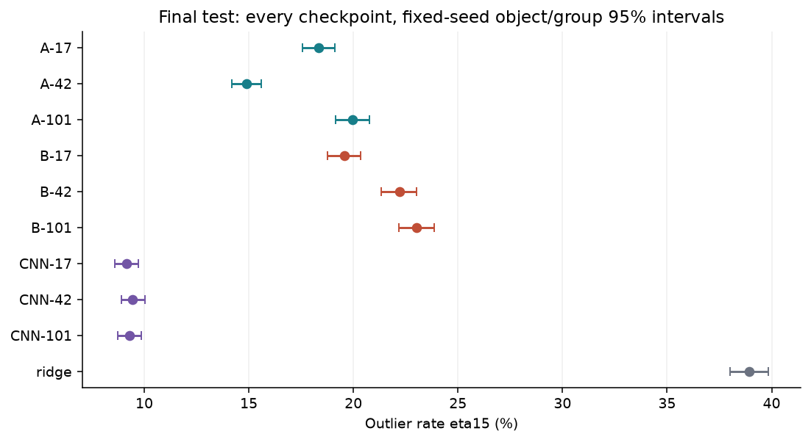
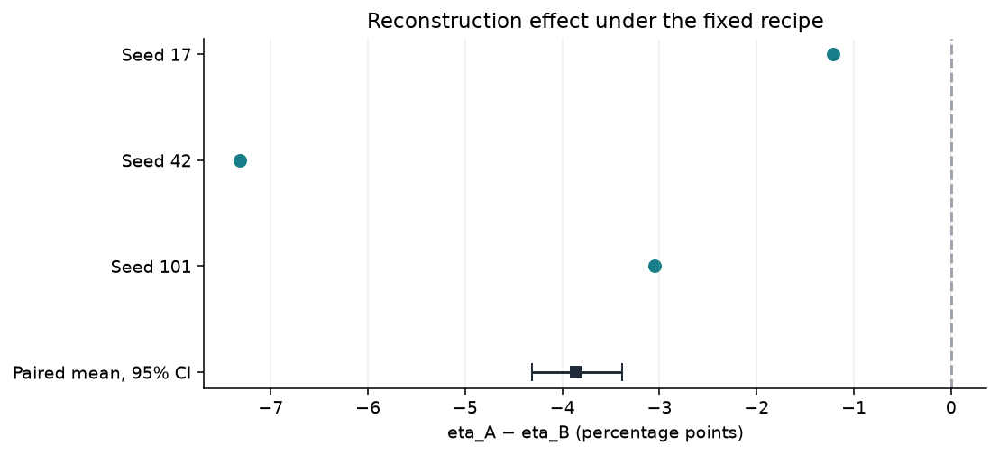
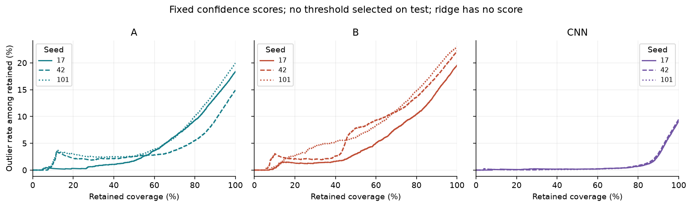
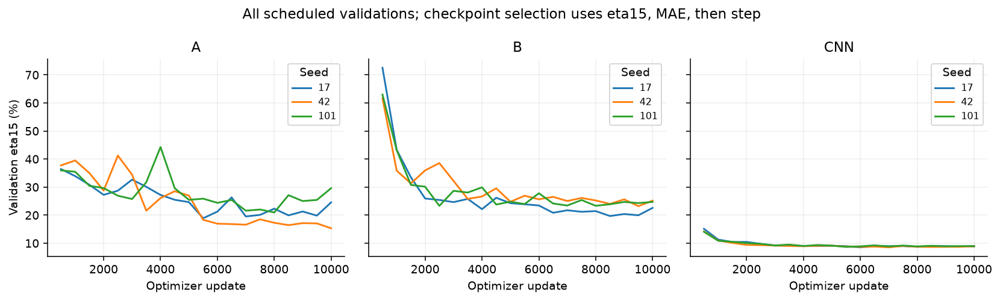

# Lote 4B — experimento completado, 10–11 de octubre de 2026

**La reconstrucción auxiliar cumple el criterio global predefinido bajo esta
receta, pero empeora el estrato con advertencia. La CNN obtiene menor error
global que ambos transformers, con mucho menor coste medido.** El test quedó
cerrado hasta congelar selección, sensibilidad y análisis. No se cambió el
modelo servido, no se reconstruyó FAISS ni se avanzó al lote 5.

| Ticket | Cierre verificado |
|---|---|
| 4B-01 | R4A-01 corregido y commiteado antes de entrenar; regresiones sintéticas y reanudación válida |
| 4B-02 | Nueve corridas de 10.000 actualizaciones; exactamente tres ajustes ridge |
| 4B-03 | 180 validaciones verificadas, emparejamiento A/B exacto, selección y sensibilidad congeladas antes del test |
| 4B-04 | Diez candidatos sobre los mismos 10.000 IDs; evaluación y análisis pareado completos |
| 4B-05 | Informe, métricas completas, figuras regeneradas, hashes e históricos verificados; commits locales y consenso actualizado |

## Pregunta, controles y ejecución

¿Añadir reconstrucción reduce los errores de redshift manteniendo datos,
arquitectura, entradas y presupuesto? A usa Lz + Lrecon; B conserva la misma
cabeza auxiliar y usa coeficiente reconstructivo cero. Ambos tienen 25.980.646
parámetros. Se conservaron inicialización, orden de muestras, máscaras,
normalización visible y pesos de clase train-only para cada semilla 17/42/101.
La traza completa y los pesos A/B coinciden exactamente para las tres semillas.
CNN tiene 912.548 parámetros y entrada completa; su comparación incluye
cambios de arquitectura y entrada. Ridge usa 128 bandas y fracciones válidas,
escalado exclusivo de train y objetivo log(1+z).

Particiones: 64.759 train, 10.000 validación y 10.000 test; todos los casos
con advertencia se conservaron. Derivados `batch4a-v1`, manifiesto SHA-256
`4c412f03920cd12afb167ed6652fa6cb01a0f82d0c0d349e47a21590f9534547`.
No se heredaron pesos históricos ni de perfiles. Se usó `configs/batch4.json`:
10.000 actualizaciones por corrida, microbatch 8 × acumulación 4, float32,
AdamW 3e-4, warmup 200 y validación completa sin máscara cada 500 pasos.
MPS, Apple M4 Pro, 48 GiB, cuatro hilos CPU; Python 3.12.13 del entorno fijado,
con imports desde `src` mediante PYTHONPATH. Dependencias y dispositivo constantes.

Código científico commiteado en `e5888d1b760940e8978d7d80dccd69ad3a3d9cac`;
huella de archivos científicos
`828a7187545d30c9dbab55a9b49cc64925cfbdbeaa9160f3f52567c6f6f2152c`.
Los commits posteriores de documentación conservaron esa huella. El plan de
análisis y la regla del candidato futuro quedaron registrados en `a3020a2`.

## Selección, sensibilidad y congelado

Cada checkpoint se eligió por menor eta15 MAP de validación, después menor MAE
normalizado y finalmente menor paso. Las 20 predicciones de validación de cada
corrida fueron verificadas por hash, IDs, etiquetas y puntuación. Ridge completó
exactamente los ajustes α = 0,1 / 1 / 10: los tres dieron eta15 de validación
38,2%; el desempate por MAE eligió 0,1. No se reentrenó con train+validación.

Antes del test se compararon las familias por su promedio de validación:
A 18,397%, B 22,073%, CNN 8,590%, ridge 38,200%. La regla registrada nominó la
familia CNN y su semilla de rango mediano en validación: **CNN-17, paso 6.000**.
Es un candidato para la evaluación operativa del lote 5, sin despliegue. No se
eligió ni cambió esta decisión mirando test; todas las semillas se reportan.

La discordancia A/B en validación fue 12,57%, 15,84% y 16,60%. Bajo transporte
a test, unidades observadas independientes y aproximación normal, las diferencias
aproximadamente detectables con potencia 80% son 0,993 / 1,115 / 1,141 pp por
semilla; semianchos nulos 95% de 0,695 / 0,780 / 0,799 pp. No son garantías de
potencia del criterio conjunto: la validación seleccionada es optimista y las
dependencias físicas desconocidas pueden ampliar la incertidumbre.

Congelado y decisión versionados en `049b748f39b58199fe2818575af7435ae2e114cd`.
La puerta previa al test pasó a las **05:42:52 del 11 de octubre, Los Ángeles**;
registró hashes, entorno, candidato, plan y generador. La evaluación autorizada
con `OPEN_FROZEN_BATCH4_TEST_ONCE` empezó después. No hubo nuevas selecciones,
entrenamientos ni umbrales tras abrir el test.

## Resultados individuales y controles

Todos los denominadores primarios son 10.000. eta15 usa error normalizado
estrictamente mayor que 0,15; MAP en las redes y predicción escalar en ridge.
Los intervalos por checkpoint usan 2.000 remuestreos de objetos/grupos, semilla
20261009. Son condicionales al checkpoint, no intervalos sobre nuevas semillas.

| Candidate | Selected step / alpha | Validation eta15 | Test outliers / N | Test eta15 (95% CI) | MAE norm | NMAD | Bias |
|---|---:|---:|---:|---:|---:|---:|---:|
| A-17 | 5500 | 18.900% | 1835/10000 | 18.350% [17.570, 19.100] | 0.161346 | 0.053797 | 0.109504 |
| A-42 | 10000 | 15.330% | 1489/10000 | 14.890% [14.190, 15.580] | 0.102242 | 0.027309 | 0.042013 |
| A-101 | 8000 | 20.960% | 1997/10000 | 19.970% [19.160, 20.770] | 0.187789 | 0.046853 | 0.131215 |
| B-17 | 8500 | 19.690% | 1956/10000 | 19.560% [18.770, 20.340] | 0.122769 | 0.055801 | 0.045994 |
| B-42 | 9500 | 23.210% | 2221/10000 | 22.210% [21.320, 23.010] | 0.246589 | 0.062658 | 0.189899 |
| B-101 | 2500 | 23.320% | 2302/10000 | 23.020% [22.170, 23.870] | 0.161258 | 0.088414 | 0.091206 |
| CNN-17 | 6000 | 8.550% | 914/10000 | 9.140% [8.590, 9.700] | 0.052081 | 0.009659 | 0.012786 |
| CNN-42 | 7000 | 8.540% | 944/10000 | 9.440% [8.890, 10.030] | 0.056981 | 0.009691 | 0.022303 |
| CNN-101 | 5500 | 8.680% | 929/10000 | 9.290% [8.730, 9.870] | 0.053222 | 0.009675 | 0.019034 |
| ridge | 0.1 | 38.200% | 3893/10000 | 38.930% [38.000, 39.830] | 0.157996 | 0.166198 | 0.029832 |

Las medias siguientes son resúmenes de tres semillas fijas, no una muestra de
30.000 objetos independientes ni una predicción ensemble. Ridge tiene un ajuste
seleccionado. La CNN presenta menor eta15 y MAE que cada transformer en este test;
ridge queda muy por detrás en eta15. No se afirma equivalencia por similitud ni
se atribuye el contraste CNN/transformer únicamente a la arquitectura.

| Familia | eta15 medio | MAE normalizado medio | NMAD medio | Sesgo medio |
|---|---:|---:|---:|---:|
| A | 17.737% | 0.150459 | 0.042653 | 0.094244 |
| B | 21.597% | 0.176872 | 0.068958 | 0.109033 |
| CNN | 9.290% | 0.054095 | 0.009675 | 0.018041 |
| ridge | 38.930% | 0.157996 | 0.166198 | 0.029832 |



## Comparación pareada y límites del beneficio

Δη = eta_A − eta_B: **−1,21 / −7,32 / −3,05 pp** para 17/42/101.
Media **−3,86 pp**, IC95 pareado **[−4,3101; −3,3867] pp**. MAE normalizado
medio: A **0,150459**, B **0,176872**, diferencia **−0,026413**.
Las tres Δη son negativas, el extremo superior del intervalo está bajo cero
y el MAE medio no empeora: **se cumple el criterio fijado en §7.5**.

El bootstrap hace 5.000 remuestreos conjuntos de los 10.000 objetos/grupos
observados para A/B y las tres semillas; una semilla no añade observaciones.
El intervalo está condicionado a esas tres semillas. No quedó establecida la
independencia física de los IDs en este snapshot. El efecto varía entre semillas:
A tiene peor MAE que B en 17 y 101; la mejora del MAE medio está impulsada por 42.
El criterio exige MAE medio, no mejoría individual en cada semilla.

**El beneficio global no es uniforme.** En los 946 objetos con advertencia,
A empeora en las tres semillas: media **+4,792 pp**, IC95 **[+2,959; +6,660] pp**.
En los 9.054 sin advertencia, la media es **−4,764 pp**, IC95
**[−5,224; −4,315] pp**. Las tasas medias con advertencia son A 71,283%,
B 66,490%, CNN 67,371% y ridge 67,653%. Una advertencia no demuestra que la
etiqueta sea falsa; estos errores se miden contra las etiquetas disponibles.
No se excluye este estrato para mejorar el titular.

| Estrato | N | Δη 17 / 42 / 101 (pp) | IC95 de la media pareada (pp) |
|---|---:|---:|---:|
| no_warning | 9054 | -1.447 / -8.493 / -4.352 | [-5.224, -4.315] |
| warning | 946 | +1.057 / +3.911 / +9.408 | [+2.959, +6.660] |
| z[0,0.5) | 4632 | +4.361 / -9.823 / -3.325 | [-3.476, -2.375] |
| z[0.5,1) | 2759 | -1.848 / -10.004 / -1.740 | [-5.425, -3.637] |
| z[1,1.5) | 1983 | -10.136 / -1.412 / +3.227 | [-4.017, -1.513] |
| z[1.5,2) | 483 | -14.700 / +9.524 / -17.598 | [-10.628, -4.555] |
| z[2,2.5) | 84 | +0.000 / -15.476 / -61.905 | [-30.556, -21.032] |
| z[2.5,inf) | 59 | +0.000 / -10.169 / -50.847 | [-26.554, -14.124] |

También hay regresiones individuales por z (por ejemplo, semilla 17 en z<0,5).
Los estratos z≥2 solo contienen 84 y 59 objetos; los subconjuntos con advertencia
en ellos contienen 2 y 4. Se conservan todos los conteos, sin agruparlos ni
omitirlos. Estos análisis por estrato no son descubrimientos corregidos por
multiplicidad. [Detalle completo](BATCH_4B_STRATA.md), incluidos calidad,
cobertura de entrada, denominadores, MAE, NMAD y sesgo.



## Riesgo–cobertura y trayectorias

Las curvas usan el score fijo de cada red, sin fijar umbrales con test. Muestran
ordenación útil del riesgo, especialmente en CNN; no prueban calibración ni
establecen una política de abstención. Ridge no tiene score definido.
La cobertura de entrada es otra variable: 323 objetos tienen cobertura
[0,9;0,99) y 9.677 tienen ≥0,99; no hay casos por debajo de 0,9. No puede
extenderse esta evidencia a entradas con mucho menos soporte.



La selección conserva checkpoints anteriores al último cuando corresponde.
Las trayectorias y la dispersión A/B desaconsejan afirmar convergencia universal;
no se amplió el presupuesto para buscar otro resultado.



## Tiempo, memoria e interrupciones

Desde el arranque de las nueve corridas hasta análisis y figuras:
**10,0469 h (10 h 02 min 49 s)**, frente a **10,1623 h estimadas** y
**15,2435 h con margen**. El tiempo de preparación, pruebas y redacción se
reporta aparte de esa ventana; no se presenta como tiempo de entrenamiento.
La serie neuronal tomó **35.875,948 s**; ridge **16,627 s**, verificación de
validación **2,737 s**, freeze **3,576 s**, test completo **261,162 s**,
análisis pareado **1,335 s** y generación del informe/figuras **5,572 s**.
Los componentes no tienen que sumar exactamente el tiempo de pared: faltan
inicio, comprobaciones, impresión y otros costes de coordinación.

| Corrida | Actualizaciones (s) | Validación (s) | Checkpoints (s) | RSS máximo (GB) | Driver MPS máximo muestreado (GB) |
|---|---:|---:|---:|---:|---:|
| A-17 | 4993.17 | 805.85 | 16.83 | 3.408 | 3.464 |
| A-42 | 4944.31 | 800.62 | 21.18 | 3.421 | 3.464 |
| A-101 | 4945.26 | 801.22 | 23.49 | 3.393 | 3.464 |
| B-17 | 5017.69 | 812.82 | 17.80 | 3.387 | 3.464 |
| B-42 | 4947.72 | 801.39 | 16.29 | 3.421 | 3.464 |
| B-101 | 4944.91 | 806.09 | 16.07 | 3.421 | 3.464 |
| CNN-17 | 198.24 | 76.52 | 1.13 | 3.061 | 0.072 |
| CNN-42 | 199.44 | 73.96 | 1.08 | 3.010 | 0.072 |
| CNN-101 | 199.17 | 74.68 | 1.09 | 3.079 | 0.072 |

Cada CNN empleó aproximadamente 4,6 minutos en componentes medidos, frente a
96–98 minutos por transformer; es una comparación de recetas con entradas
diferentes. Ridge: features train 12,718 s, validación 1,929 s y tres solves
0,120 s; RSS máximo de proceso 3,260 GB. Test: RSS máximo 1,473 GB. GB son
unidades decimales. RSS y asignaciones MPS en memoria unificada no se suman.
El driver se muestrea después de las actualizaciones: no es un pico absoluto
garantizado. El RSS de corridas completas supera el de los perfiles cortos;
el presupuesto basado en perfiles no garantizaba ese valor.

**Cero interrupciones reales, cero reanudaciones del test.** Se conservaron las
advertencias existentes de PyTorch; ninguna corrida ni semilla se eliminó.
Todas las corridas registraron cero fallbacks de normalización. La reanudación
se comprobó con fixtures sintéticas, no provocando aperturas extra del test real.

## R4A-01

The common experiment identity now includes device, environment and validation
identity. Freeze rejects heterogeneous collections and a changed current
environment. Final evaluation checks every candidate and checkpoint identity,
the current environment, requested device and its availability before registering
the opening, creating its output directory or loading any test data. The same
preflight applies on resume, including candidates with persisted predictions.
Ridge uses NumPy on the host CPU; it does not inherit a neural MPS device.
Its recorded Python/platform/dependency environment must match the experiment.

Ten new synthetic cases cover mixed CPU/MPS runs, mixed environments, ridge
environment mismatch, requested-device mismatch, changed current environment,
tampered frozen candidate/checkpoint identities, and interruption after three
predictions followed by resumption without rewriting those predictions.
Before correction: 9 failed, 1 passed. Afterwards: 29 relevant tests passed;
the complete FM suite passed 99 tests on Python 3.12.13 and 99 on Python 3.9.6.
The original independent mixed-device reproduction now fails at freeze with
`Runs do not share the same recipe/data/code/device/environment`.
Only synthetic data were used for these regressions.

Private evidence and the initial Git-state record:
`/Users/jirustaroure/.local/state/spectra-consolidation/lote-4b-preparation-20261010/`.
Both originals started on the expected batch-4A commits and now use
`codex/lote-4b`. The sole pre-existing FM change was the untracked historical
CSV; Copilot was clean and needs no implementation change.


## Artefactos, verificación y reproducción

Corridas, pesos, predicciones y matrices permanecen fuera de Git:
`/Users/jirustaroure/.local/state/spectra-consolidation/lote-4b-01/`.
El inventario identifica **641 archivos / 6.059.400.278 bytes** de ejecución
(excluye el propio subdirectorio de informe y los logs de preparación).
[Inventario](evidence/batch4b-artifacts.json) contiene rutas, tamaños y SHA-256,
incluidos logs externos, figuras y referencia a los derivados.
[Resultados completos](evidence/batch4b-results.json),
[análisis pareado](evidence/batch4b-paired-analysis.json),
[aceptación](evidence/batch4b-acceptance.json),
[congelado](evidence/batch4b-frozen.json) y
[decisión de validación](evidence/batch4b-validation-decision.json).

Los diez NPZ finales coinciden en los 10.000 IDs, etiquetas, grupos y cobertura,
sin rechazos. La apertura registrada coincide con la identidad final. Repetir
el análisis desde predicciones produjo métricas, tabla y cuatro PNG idénticos
byte a byte; las figuras también se inspeccionaron visualmente. No se repitió
inferencia. 74/74 históricos FM y 169/169 Copilot conservan tamaños y hashes.
El CSV histórico sigue sin versionar y mantiene SHA-256
`db2a7f4d26780d0787f9f9bea9118f7ccd992494b0a7cd382d9152ff92ce4eab`.

Para regenerar **solo** resultados y figuras desde lo ya persistido, usar un
nuevo directorio de salida:

```sh
cd "/Users/jirustaroure/Desktop/FINAL PROJECT DEEP LEARNING"
PYTHONPATH=src /Users/jirustaroure/.local/state/spectra-consolidation/lote-2-20261009/wheel-env/bin/python \
  scripts/report_batch4b.py report \
  --runs /Users/jirustaroure/.local/state/spectra-consolidation/lote-4b-01 \
  --validation-review /Users/jirustaroure/.local/state/spectra-consolidation/lote-4b-01/validation-review.json \
  --output /ruta/nueva/para/el/informe
```

## Conclusión defendible y siguiente lote

Aprendimos que la tarea auxiliar mejora el criterio global de redshift **bajo
esta receta y presupuesto**, con variación por semilla y perjuicio en las
etiquetas advertidas. La CNN es la alternativa práctica más precisa y barata
observada; el contraste causal de reconstrucción sigue siendo solo A/B.
No demostramos un foundation model, transferencia, robustez a otros instrumentos,
independencia física, probabilidad calibrada ni superioridad con otras recetas
u otras semillas. Tampoco demostramos que el agente corrija redshifts.

Julian debe poder defender la normalización posterior a la máscara, los pesos
train-only, qué aísla A/B y qué no aísla CNN, selección sin test, presupuesto fijo,
bootstrap conjunto condicionado a semillas y por qué el daño en advertencias
forma parte del resultado. Debe distinguir autoría y decisiones personales de
la asistencia de IA sin atribuirlas solo por los commits.

Lote 5 pendiente: separar model_z/alternativas/observaciones; corregir B7/B9,
validez/SNR, orden y cobertura, ambigüedad y controles negativos; verificar las
cinco tools MCP y errores tipados; evaluar citas/exactitud con conjunto ciego y
presupuesto propio; quick start limpio y demostración; preparar después una
publicación coherente. Antes de cualquier cambio del servicio, evaluar el
candidato CNN ya nominado y su contrato de inferencia. No afinar métodos ni
umbrales reutilizando este test como validación. Nada de ese lote se ejecutó aquí.
