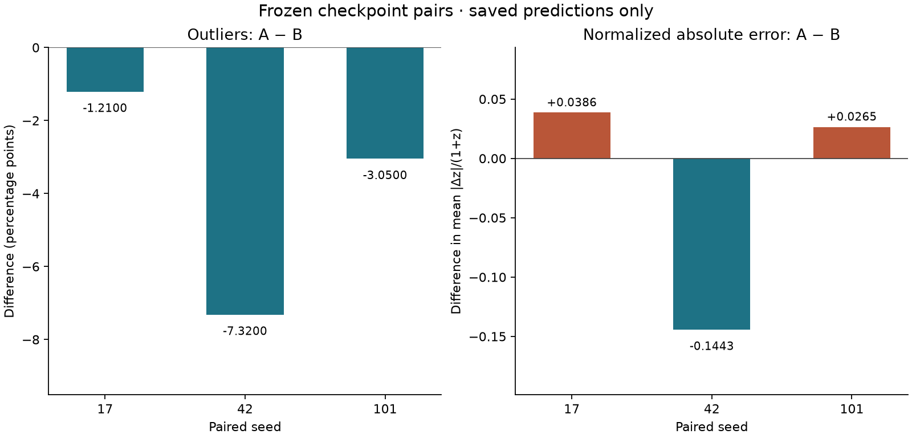

# A/B desde predicciones persistidas

La figura se regeneró en 5C sin cargar modelos ni hacer inferencia. Fuente
canónica: los seis NPZ final-test congelados, contrastados con
`evidence/batch4b-artifacts.json`. Recuento recalculado en
[batch5c-ab-persisted.json](evidence/batch5c-ab-persisted.json).



A usa Lz + Lrecon; B conserva arquitectura y cabeza auxiliar con coeficiente
reconstructivo cero. Inicialización, muestras, máscaras, entradas y presupuesto
están emparejados. Se representan los tres pares seleccionados previamente por
validación; no se seleccionó ningún checkpoint nuevo.

| Semilla | N | Outliers A | Outliers B | Δη A−B (pp) | Δ media de error normalizado |
|---|---:|---:|---:|---:|---:|
| 17 | 10000 | 1835 | 1956 | −1.21 | +0.038576 |
| 42 | 10000 | 1489 | 2221 | −7.32 | −0.144347 |
| 101 | 10000 | 1997 | 2302 | −3.05 | +0.026530 |

Outlier significa |z_pred−z_true|/(1+z_true)>0.15. A tiene menos outliers en
los tres pares, pero la media del error absoluto normalizado empeora en 17 y
101. La mejora media está impulsada por 42. Tres semillas no establecen una
mejora uniforme ni generalización a otros checkpoints. No se usan objetos como
réplicas independientes de semillas. El intervalo histórico está condicionado
a los pares; esta figura no lo sustituye.

Reproducción (intérprete instalado, cwd fuera de repos, salida nueva):

```sh
"$S5C_ENV/bin/python" -I -B "$S5C_FM/scripts/render_batch5c_ab.py" \
  --runs "$S5C_RUNS_4B" \
  --inventory "$S5C_FM/docs/evidence/batch4b-artifacts.json" \
  --output /ruta/privada/nueva/figuras
```

Produce PNG, SVG y JSON con hashes. Solo lee predicciones persistidas y no
abre batch4a-v1/test. No compara CNN con v2.1: sus cifras proceden de protocolos
y poblaciones distintos. El agente histórico conserva su resultado negativo,
139/150 frente a 119/150. [Contexto y límites](BATCH_4B.md).
